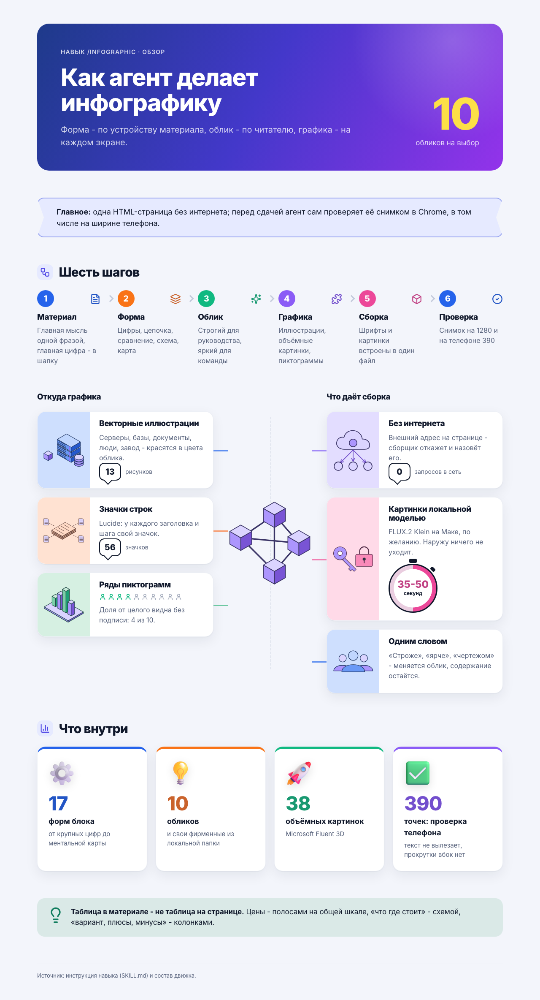

# Инфографика для агента IWE

Навык для Claude Code в рабочей среде IWE: агент делает инфографику одной страницей, как Джемини. Форму он подбирает под устройство материала (цифры, цепочка, сравнение, схема, сроки, ментальная карта), облик под читателя (двенадцать обликов и ваши фирменные). На каждом экране есть графика: векторные иллюстрации, объёмные картинки и, по желанию, картинки локальной модели FLUX.2. Результат — один HTML-файл, который открывается без интернета и печатается в PDF. Перед сдачей агент сам проверяет страницу снимком в Chrome, в том числе на ширине телефона.



Та же страница в десяти обликах и образцы другого устройства: [лист обликов](examples/looks-sheet.png), [лист форм](examples/types-sheet.png).

## Установка

Нужны Python 3.9 или новее (на Маке уже есть) и Google Chrome (для проверки снимком).

```bash
cd ~/IWE                                   # ваша рабочая папка IWE
git clone https://github.com/277zdwvw9f-pixel/iwe-infographic.git
ln -s ../../iwe-infographic .claude/skills/infographic
```

Хранилище лежит рядом с остальными, а навык подключён ссылкой. Новая сессия агента его увидит: скажите «сделай инфографику по этому документу» или вызовите `/infographic`. Если папки `.claude/skills` ещё не было, выполните в Claude Code `/reload-skills` или перезапустите сессию.

**Обновление:** `git -C ~/IWE/iwe-infographic pull`.

## Картинки локальной моделью (по желанию)

Без модели навык работает: графику дают иллюстрации, объёмные картинки и значки. Модель добавляет картинки по теме страницы: шапку, центр ментальной карты, фоновую панораму. Всё считается на вашем Маке, наружу ничего не уходит.

Нужен Мак на Apple Silicon (проверено на M4 с 24 ГБ памяти), около 6 ГБ под окружение и модель и временно ещё около 20 ГБ на скачивание.

```bash
uv python install 3.11                     # или brew install python@3.11
python3.11 -m venv ~/.local/share/iwe-imagegen/venv
~/.local/share/iwe-imagegen/venv/bin/pip install mflux==0.22.0
# one-off: download FLUX.2 Klein 4B (Apache-2.0) and keep a 4-bit copy that loads fast
~/.local/share/iwe-imagegen/venv/bin/mflux-save --model flux2-klein-4b --quantize 4 \
    --path ~/.local/share/iwe-imagegen/models/flux2-klein-4b-q4
```

После сохранения полную копию модели из кэша Hugging Face (`~/.cache/huggingface/hub`) можно удалить: навык берёт сжатую копию, картинка рисуется за 35-50 секунд. Без сжатой копии модель пересжимается при каждом запуске, и Мак уходит в подкачку.

## Готовые картинки (`library/`)

Картинки, уже нарисованные моделью FLUX.2 Klein 4B на Маке, в десяти встроенных обликах: 85 сюжетов
(серверы, базы данных, документы, логистика, лаборатория, люди, процессы и др.), по пять вариантов.
Каталог `library/catalog.tsv` с русскими подписями, страница просмотра `library/index.html`.
Сжаты в WebP до 512 точек. Брак (не тот предмет, съеденные белые части) в библиотеку не попадает.

```bash
python3 -I engine/library.py find сервер авария --look bright      # что подходит, сначала облик страницы
python3 -I engine/library.py take bright/failover-v2 --to art-bright/failover.webp
```

Без своей локальной библиотеки `library.py` берёт эту папку. Своя библиотека (`IG_LIBRARY_DIR`, по умолчанию
`DS-strategy/local/infographic-library/`) хранит и фирменные облики, они сюда не выкладываются; общие облики
из неё выгружаются сюда `engine/library_publish.py`.

## Свой фирменный облик

Фирменные шрифты и логотипы обычно лицензированы организации, поэтому они живут не в этом хранилище, а в локальной папке: по умолчанию `~/IWE/DS-strategy/local/infographic-brands/<имя>/`, другую можно задать переменной `IG_BRAND_DIRS`. В папке облика:

| Файл | Что в нём |
|---|---|
| `look.json` | `{"name": "acme", "title": "Акме", "use": "материалы компании Акме", "fonts": ["Acme Sans"], "palette": "green and white colours"}` |
| `fonts.css` | `@font-face` с `font-family: 'Acme Sans'` и `src: url(acme.woff2)`; шрифт должен содержать кириллицу |
| `look.css` | переменные облика под `html[data-look="acme"]` (цвета, шрифты, скругления; образцы — двенадцать обликов в `engine/looks.css`) и логотип через `url(logo.svg)` |
| файлы | шрифты, логотип и всё, на что ссылаются `fonts.css` и `look.css`: сборщик встроит их в страницу |

Сборщик подхватит облик сам, а агент будет брать его для материалов организации из поля `use`. Совет из опыта: один фирменный цвет на страницу и его оттенки, иначе получается пёстро.

## Что внутри

| Папка | Что |
|---|---|
| `SKILL.md` | инструкция агенту: как выбрать форму и облик, где взять графику, как собрать и проверить |
| `engine/` | сборщик `build.py`, макетные листы `sheet.py`, картинки моделью `gen_image.py`, библиотека готовых картинок `library.py`, иллюстрации `illus.py`, облики `looks.css`, шрифты и значки в `assets/`; подробности — `engine/README.md` |
| `examples/` | исходники четырёх образцов (узел с графикой, цикл, пирамида, матрица 2×2), снимок образца и макетные листы |
| `docs/service-clause.md` | обещание навыка: что он даёт, сценарии, чего не делает |
| `tests/` | проверки сборщика: `python3 -m unittest tests/test_infographic.py` |

## Лицензии

Код — MIT (`LICENSE`). Шрифты — SIL Open Font License 1.1 (`engine/assets/fonts/OFL.txt`), значки — Lucide, ISC (`engine/assets/icons/LICENSE.txt`), объёмные картинки — Microsoft Fluent Emoji, MIT (`engine/assets/emoji3d/LICENSE.txt`). Модель FLUX.2 Klein 4B — Apache-2.0, скачивается отдельно. Картинки в `library/` нарисованы этой моделью и выложены под той же лицензией MIT, что и код.
